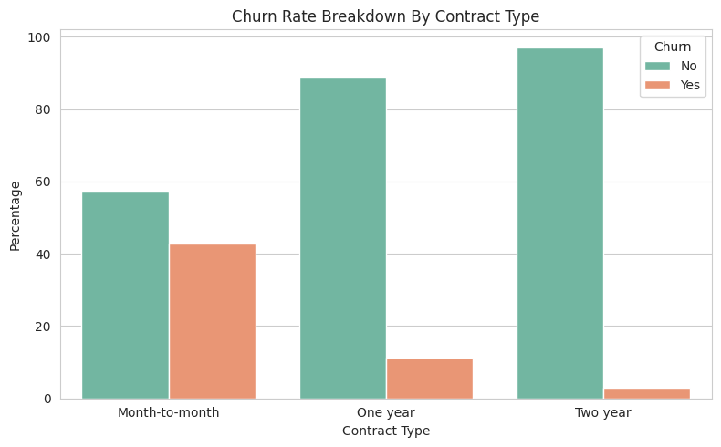
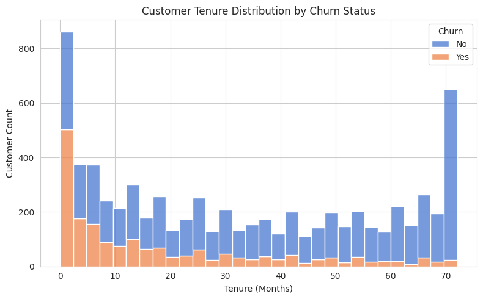
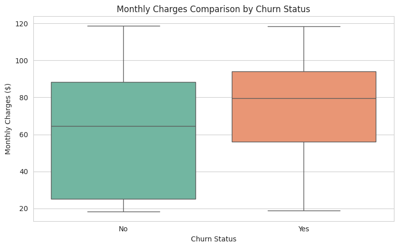

# 📉 Telecom Customer Churn Investigation & Retention Pipeline

[](https://www.python.org/)
[](https://jupyter.org/)
[](https://pandas.pydata.org/)
[](https://seaborn.pydata.org/)
[](LICENSE)
[]()

> **Arrowstack Data Science 1-Month Internship — Project 1**  
> **Author:** Emmanuel Bright Chetachi | **App / Roll ID:** `AS-2026-18951`

---

## 📌 Executive Summary & Problem Framing

Customer attrition represents one of the largest revenue leaks in subscription-based telecommunications. Acquiring new customers costs substantially more than retaining existing ones; therefore, understanding the behavioral, operational, and contractual signals driving subscriber departures is paramount.

This project delivers an end-to-end exploratory data investigation and automated data pipeline evaluating **7,043 customer accounts** from a telecommunications provider. By pairing rigorous data auditing with statistical segmentation and visual analytics, this investigation pinpoints root causes of customer turnover and delivers data-backed retention recommendations for business stakeholders.

* **Primary Stakeholder:** Head of Customer Success, Retention Operations Manager, Product Pricing Lead.
* **Core Business Objective:** Identify high-risk subscriber segments, isolate friction points in contract and billing modalities, and inform targeted onboarding and contract migration programs to minimize churn.

---

## 🚀 Key Findings & Quantitative Metrics

| Metric Dimension | Statistical Observation | Business Impact & Assessment |
| :--- | :--- | :--- |
| **Overall Attrition Rate** | **26.54%** (1,869 / 7,043 customers churned) | High subscriber turnover requiring proactive retention intervention. |
| **Contract Type Vulnerability** | Month-to-Month: **42.71%**<br>One-Year: **11.27%**<br>Two-Year: **2.83%** | Contract commitment is the single strongest structural deterrent against churn; short-term plans carry ~15x the risk of 2-year plans. |
| **Early Tenure Vulnerability Window** | **0 – 12 Months:** **47.44% churn**<br>13 – 24 Months: **28.71%**<br>25 – 48 Months: **20.39%**<br>49 – 72 Months: **9.51%** | Nearly **half of all new subscribers churn within their first year**, revealing critical onboarding friction in the first 90–360 days. |
| **High-Risk Product Combo** | Fiber Optic + Month-to-Month: **54.61% churn** | Premium monthly pricing paired with zero contractual lock-in creates acute price sensitivity and dissatisfaction exposure. |
| **Payment Channel Friction** | Electronic Check: **45.29% churn**<br>Mailed Check: **19.11%**<br>Bank Transfer (Auto): **16.71%**<br>Credit Card (Auto): **15.24%** | Manual, friction-heavy payment methods correlate directly with elevated subscriber cancellation rates (~3x automated methods). |

---

## 📊 Visual Analytics & Exploratory Insights

### 1. Churn Rate Breakdown by Contract Type

* **Finding:** While month-to-month contracts account for a significant share of the customer base, over 42.7% terminate their service. In contrast, 1-year and 2-year multi-year agreements dramatically suppress churn down to 11.3% and 2.8% respectively.

### 2. Customer Tenure Distribution by Churn Status

* **Finding:** The tenure distribution demonstrates an extreme left-skewed spike in attrition among zero-to-twelve-month subscribers (mean churned tenure: **17.98 months** vs. **37.57 months** for retained customers; median churned tenure is just **10 months**). Once subscribers surpass the 24-month mark, retention stabilizes substantially.

### 3. Monthly Charges Comparison by Churn Status

* **Finding:** Churned customers have a notably higher median monthly billing charge (**$79.65**) compared to retained customers (**$64.45**), demonstrating that high recurring costs without perceived ongoing value acceleration directly trigger subscriber cancellations.

---

## 🧹 Data Quality Audit & Cleaning Log

A robust exploratory audit was conducted on the raw 7,043-record dataset:

1. **Duplicate Verification:**
   - Evaluated row-level uniqueness across all 21 feature attributes.
   - **Result:** `0` duplicate rows detected.
2. **Hidden Whitespace & Type Anomaly in `TotalCharges`:**
   - Raw `TotalCharges` was loaded as an `object` (string) data type rather than numeric float.
   - **Root Cause Identified:** 11 records contained blank whitespace strings (`" "`).
   - **Domain Diagnosis:** All 11 instances corresponded strictly to brand-new subscribers with `tenure = 0` months who had not yet completed a billing cycle.
3. **Imputation & Normalization Protocol:**
   - Successfully coerced `TotalCharges` to floating-point numbers.
   - Imputed `tenure == 0` missing values with `0.0`.
   - Exported clean, verified dataset to [`cleaned_customer_churn.csv`](cleaned_customer_churn.csv).

---

## 💡 Strategic Retention Recommendations

Based on empirical data evidence, the following actionable interventions are proposed:

1. **90-Day Early Onboarding Intervention Program:**
   - Deploy dedicated customer success outreach, guided technical setup, and check-in surveys during the first 90 days for all new signups, specifically targeting Month-to-Month Fiber Optic subscribers.
2. **Contract Migration & Loyalty Discount Incentive:**
   - Introduce targeted incentives (e.g., free speed tier boost, security package add-on, or a 10% discount) to migrate month-to-month subscribers into 12-month or 24-month commitments before month 6.
3. **Automated Billing Conversion Campaigns:**
   - Incentivize customers using manual Electronic Checks with a one-time bill credit (e.g., $5–$10) to switch to automated Credit Card or Bank Transfer auto-pay, eliminating recurring payment friction.
4. **Value-Add Bundling for Fiber Optic Plans:**
   - Address the 54.6% churn rate on Fiber Optic month-to-month plans by bundling streaming, cyber-protection, or tech-support subscriptions to improve perceived price-to-value ratio.

---

## 📁 Repository Structure

```
.
├── EMMANUEL_BRIGHT_CHETACHI_Customer__Churn_Investigation.ipynb  # Interactive Jupyter/Colab Notebook
├── customer_churn_pipeline.py                                    # Modular, standalone Python data pipeline
├── WA_Fn-UseC_-Telco-Customer-Churn.csv                         # Original raw Telco dataset
├── cleaned_customer_churn.csv                                    # Verified, cleaned production dataset
├── output/
│   └── figures/
│       ├── churn_by_contract.png                                 # Churn by Contract Type visualization
│       ├── tenure_distribution.png                               # Tenure distribution by churn visualization
│       └── monthly_charges_boxplot.png                           # Monthly charges boxplot visualization
├── requirements.txt                                              # Python environment dependencies
├── .gitignore                                                    # Standard Git ignore configurations
└── README.md                                                     # Professional portfolio documentation
```

---

## 🛠️ Tech Stack & Dependencies

* **Language:** Python 3.8+
* **Data Processing & Analytics:** `pandas`, `numpy`, standard library `csv`
* **Data Visualization:** `matplotlib`, `seaborn`
* **Development Environments:** Google Colab, Jupyter Notebook, Visual Studio Code

---

## 💻 How to Run the Project Locally

### 1. Clone the Repository
```bash
git clone https://github.com/Ecoplex82/ARROWSTACK_Customer_Churn_Investigation.git
cd ARROWSTACK_Customer_Churn_Investigation
```

### 2. Set Up a Virtual Environment & Install Dependencies
```bash
# Create virtual environment
python -m venv venv

# Activate virtual environment (Windows)
.\venv\Scripts\activate
# Activate virtual environment (macOS/Linux)
source venv/bin/activate

# Install requirements
pip install -r requirements.txt
```

### 3. Run the Automated Pipeline via CLI
Execute the end-to-end data audit, cleaning, and statistical reporting:
```bash
python customer_churn_pipeline.py
```

### 4. Run the Jupyter Notebook
```bash
jupyter notebook EMMANUEL_BRIGHT_CHETACHI_Customer__Churn_Investigation.ipynb
```

---

## 👨‍💻 Author & Acknowledgments

* **Author:** Emmanuel Bright Chetachi
* **Role / Track:** Data Science Intern
* **App / Roll ID:** `AS-2026-18951`
* **Email:** [emmanuelchetachibright@gmail.com](mailto:emmanuelchetachibright@gmail.com)
* **GitHub:** [@Ecoplex82](https://github.com/Ecoplex82)
* **Internship Program:** Arrowstack Data Science 1-Month Internship

---

## 📄 License

This project is licensed under the MIT License — see the [LICENSE](LICENSE) file for details.